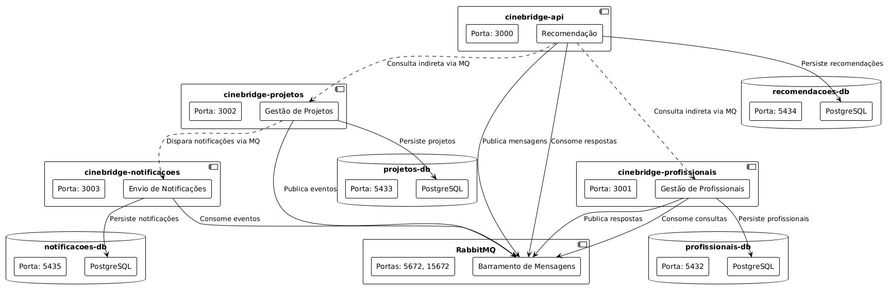

# Quarta atividade — containerização

A ATVIV divide a Cinebridge em contêineres que conversam por uma rede interna do Docker e por um barramento RabbitMQ. O microsserviço de recomendação das atividades anteriores virou o `cinebridge-api`; cadastro de profissionais, ciclo de vida dos projetos e notificações ganharam serviços e bancos próprios.

O diagrama acima é o do enunciado. A versão em PlantUML, com os nomes das filas, está em [diagrama-implantacao.puml](diagrama-implantacao.puml).

## Contêineres

| Contêiner | Imagem | Porta no host | Responsabilidade | Banco |
|---|---|---|---|---|
| `cinebridge-api` | `cinebridge/api:4.0.0` (build) | 3000 | Recomendação e orquestração; ponto de entrada REST | `recomendacoes-db` (5434) |
| `cinebridge-profissionais` | `cinebridge/profissionais:4.0.0` (build) | 3001 | Cadastro, competências, avaliações e disponibilidade | `profissionais-db` (5432) |
| `cinebridge-projetos` | `cinebridge/projetos:4.0.0` (build) | 3002 | Ciclo de vida, métricas e resultados dos projetos | `projetos-db` (5433) |
| `cinebridge-notificacoes` | `cinebridge/notificacoes:4.0.0` (build) | 3003 | E-mails (simulados) e mensagens internas | `notificacoes-db` (5435) |
| `cinebridge-mq` | `rabbitmq:3-management-alpine` | 5672, 15672 | Barramento de mensagens e interface de gerenciamento | — |
| `*-db` (4) | `postgres:15-alpine` | 5432–5435 | Um PostgreSQL por serviço, com volume próprio | — |

Cada serviço só acessa o próprio banco. Não há consultas entre bancos nem chamadas HTTP entre serviços: toda comunicação entre eles passa pelo RabbitMQ.

## Filas

Todas as filas de trabalho são **duráveis** e têm uma fila de falhas (`<fila>.falhas`, via *dead letter*). As mensagens de eventos são **persistentes** e publicadas em um canal de confirmação (*publisher confirms*); o consumo usa **ack manual**.

| Fila | Tipo | Produtor → consumidor | Conteúdo |
|---|---|---|---|
| `consulta-profissionais` | RPC | api → profissionais | `{ operacao: 'listar', criterios }`, `{ operacao: 'detalhar', id }` ou `{ operacao: 'avaliar', id, avaliacao }` |
| `consulta-projetos` | RPC | api → projetos | `{ operacao: 'buscar', id }` ou `{ operacao: 'listar', status? }` |
| `eventos-recomendacoes` | Eventos | api → projetos | Eventos da outbox do recomendador: `recomendacao.gerada`, `convite.criado`, `convite.respondido`, `membro.substituido`, `equipe.confirmada`, `equipe.reaberta`, `projeto.reavaliado`, `pagamentos.processados`… |
| `eventos-projetos` | Eventos | projetos → notificações | `projeto.criado`, `projeto.atualizado` e `projeto.finalizado`, com o `motivo` (evento de origem), destinatários e métricas |

**RPC.** O solicitante publica o pedido na fila durável com `replyTo` e `correlationId`. A resposta chega na **fila de retorno** do solicitante: o nome é gerado com um UUID (`cinebridge-api.respostas.<uuid>`), a fila é exclusiva e é removida quando a conexão fecha. Usar uma fila de retorno por instância, e não por requisição, evita criar e apagar uma fila a cada chamada; o `correlationId` associa cada resposta à sua requisição. O pedido leva `expiration` igual ao prazo de espera (2,5 s), para que um serviço que volte depois não processe consultas que ninguém mais aguarda. A resposta é `{ ok: true, dados }` ou `{ ok: false, erro: { mensagem, status } }`, e o status equivale ao HTTP (404, 422, 500…).

**Eventos.** Se o processamento falhar, a mensagem volta para a fila uma vez; se falhar de novo, vai para `<fila>.falhas`, onde pode ser inspecionada pela interface do RabbitMQ.

O código da mensageria (`mensageria.ts`, com `amqplib`) é igual nos quatro serviços. Cada serviço é implantado e versionado sozinho, por isso o arquivo é copiado em vez de virar um pacote compartilhado; `npm run verificar:mensageria` confirma que as cópias não divergiram.

## Fluxo de uma recomendação

1. `POST /projetos` no `cinebridge-api`. O catálogo pede os profissionais em `consulta-profissionais`; o `cinebridge-profissionais` consulta o `profissionais-db` e responde na fila de retorno.
2. O recomendador forma a equipe e grava projeto, equipe, recomendação e o evento `recomendacao.gerada` **na mesma transação** do `recomendacoes-db` (outbox da ATVII).
3. O worker da outbox publica o evento em `eventos-recomendacoes` e só o marca como entregue depois da confirmação do RabbitMQ. Se o broker estiver fora, o evento continua pendente e é reenviado com espera crescente.
4. O `cinebridge-projetos` aplica o evento ao registro do projeto (cria na primeira vez), atualiza métricas e resultados e publica `projeto.criado` em `eventos-projetos`.
5. O `cinebridge-notificacoes` consome o evento; a central (Observer) aciona os canais `email` e `interno`, que gravam no `notificacoes-db`.
6. Convites, respostas, confirmação e pagamento seguem o mesmo caminho. O evento `pagamentos.processados` finaliza o projeto (`projeto.finalizado`).

`GET /projetos/:id/acompanhamento` no `cinebridge-api` mostra o registro mantido pelo serviço de projetos, obtido pela fila `consulta-projetos` (a “consulta indireta via MQ” do diagrama).

## Entrega e consistência

| Situação | Comportamento |
|---|---|
| RabbitMQ fora do ar | Os serviços reconectam sozinhos (espera de 0,5 s a 15 s) e refazem filas e consumidores. `/health` responde 503 enquanto isso. Eventos do recomendador ficam na outbox. |
| `cinebridge-profissionais` fora do ar | A consulta expira em 2,5 s. A recomendação usa o último cadastro válido (até 5 min) ou retorna uma equipe parcial marcada como `degradada`, como na ATVI. Convites exigem uma leitura válida (503). |
| `cinebridge-projetos` fora do ar | Os eventos esperam em `eventos-recomendacoes` e são processados quando o serviço volta. `/acompanhamento` responde 503. |
| Evento entregue duas vezes | O serviço de projetos registra o id de cada evento aplicado (`eventos_processados`) e não o aplica de novo; reenvia a mesma publicação, com o mesmo id. As notificações têm id determinístico (`sha256(evento, canal, destinatário)`) e não duplicam. |
| Eventos concorrentes do mesmo projeto | `prefetch 1` no consumidor de projetos e um *advisory lock* por projeto no PostgreSQL. |
| Cadastro manual de projeto com o broker fora | A publicação acontece antes do commit; sem a confirmação do RabbitMQ a transação é desfeita e a API responde 503. |

As notificações e o registro no serviço de projetos são **eventualmente consistentes**: aparecem alguns milissegundos depois da resposta HTTP do recomendador.

## Observer no serviço de notificações

`CentralEventosProjeto` é o sujeito; `NotificadorEmail` e `NotificadorInterno` são observadores que herdam de `NotificadorCanal`. O consumidor da fila só conhece a central. A variável `CANAIS` escolhe os assinantes sem mudar o consumidor. Se um observador falhar, a central propaga o erro para que a mensagem seja reentregue; os canais que já gravaram não duplicam. Os textos variam por motivo do evento e por destinatário (produtor ou profissional). O e-mail é um **registro local com log**, sem servidor SMTP, como na ATVIII.

## Alterações no recomendador (código da ATVIII)

| Alteração | Arquivo |
|---|---|
| `AdaptadorProfissionaisMQ`: nova implementação de `AdaptadorProfissional` (Adapter da ATVIII) que consulta a fila em vez do banco local | `src/infrastructure/adaptadores/profissionais-mq.ts` |
| `PublicadorEventosMQ`: observador do barramento interno que encaminha a outbox ao RabbitMQ | `src/infrastructure/publicador-eventos.ts` |
| Os eventos levam um `contexto` com o resumo do projeto e da equipe, para o serviço de projetos não precisar consultar o recomendador de volta | `src/application/service.ts` |
| Migração `ProfissionaisDistribuidos`: membros e convites deixam de ter chave estrangeira para a tabela local de profissionais | `src/infrastructure/migration-distribuida.ts` |
| `/health` verifica banco e RabbitMQ; nova rota `/projetos/:id/acompanhamento`; `POST /profissionais` e `/projetos/:id/notificacoes` passam aos serviços próprios | `src/http/app.ts` |
| Mensageria e migrações na inicialização (`AMQP_URL`, `DB_MIGRAR`) | `src/server.ts` |

Sem `AMQP_URL`, a API mantém o comportamento da ATVIII (modo autônomo). Os testes da ATVII e da ATVIII continuam passando nesse modo; os testes novos cobrem o modo distribuído. Os padrões das atividades anteriores (Strategy, Template Method, Observer, Visitor, Prototype, Factory Method, Abstract Factory, Adapter, Composite e Decorator) foram preservados.

## Dockerfiles

Os quatro seguem a sequência pedida: imagem base Node Alpine, `WORKDIR /usr/src/app`, cópia de `package.json` e `package-lock.json`, instalação das dependências, cópia do código, `EXPOSE` da porta e comando de inicialização. Além disso:

- `npm ci --omit=dev`, para instalar exatamente o lock e sem dependências de desenvolvimento;
- `curl` instalado para o healthcheck, porque a imagem Alpine não o traz;
- execução como usuário `node`, sem privilégios de root;
- `CMD ["node", ...]` em vez de `npm start`, para que o processo receba o `SIGTERM` do `docker stop` e encerre conexões de forma ordenada (com `init: true` no Compose);
- `.dockerignore` sem `node_modules`, testes e `.env`.

### Imagem base

O enunciado sugere `node:18-alpine`. O projeto usa **`node:24-alpine`**, pelos motivos abaixo:

1. o Node.js 18 chegou ao fim do suporte em 30/04/2025 e não recebe mais correções de segurança;
2. o Fastify 5, usado desde a ATVI, exige Node.js 20 ou superior;
3. desde a ATVI o projeto executa TypeScript diretamente pelo Node.js 24 (remoção de tipos), sem etapa de compilação para `dist/`.

A imagem pode ser trocada pelo argumento `NODE_IMAGE` do Dockerfile, mas versões anteriores à 24 não executam este código.

## Health checks

Cada serviço expõe `GET /health`, que retorna 200 somente se o banco responde (`SELECT 1`) e a conexão com o RabbitMQ está ativa; caso contrário, 503 com o que está indisponível. O Compose usa `curl -fsS http://localhost:<porta>/health`. Os bancos usam `pg_isready` e o RabbitMQ, `rabbitmq-diagnostics check_port_connectivity`. Os serviços só iniciam depois que seu banco e o RabbitMQ estão saudáveis (`depends_on: condition: service_healthy`).

## Rede e segurança

- `cinebridge-net` é uma rede `bridge` própria; os contêineres se encontram pelo nome do serviço (`cinebridge-mq`, `projetos-db`…).
- As portas dos bancos e do AMQP (5672) são publicadas **apenas em 127.0.0.1**. As APIs e a interface de gerenciamento do RabbitMQ ficam acessíveis pelo host.
- Uma rede `internal: true` impediria também a publicação das portas no host, exigida pelo enunciado; por isso o isolamento dos bancos é feito pela publicação somente em loopback.
- As credenciais (`cinebridge/cinebridge`, `guest/guest`) são de **desenvolvimento local** e ficam nos arquivos `docker.env` de cada serviço. Antes de expor o ambiente, troque-as.

## Compatibilidade de plataformas

| Plataforma | Requisito |
|---|---|
| Windows 10 ou superior | Docker Desktop com backend WSL 2 (Windows 10 21H2 ou superior; Windows 11) |
| Ubuntu 24.04.3 ou superior e derivadas | Docker Engine com o plugin Compose (`docker-compose-plugin`) |

Para que funcione igual nas duas: nenhum *bind mount* do host (apenas volumes nomeados, sem problemas de caminhos ou permissões do Windows), finais de linha LF forçados por `.gitattributes` e scripts auxiliares em Node.js, sem shell script. As portas podem ser trocadas por variáveis (`PROFISSIONAIS_DB_PORTA` etc.) quando já houver um PostgreSQL local.

## Validação

Em **22/11/2026**, no Windows 11 (build 26200) com Docker Desktop 29.7.2 (Compose 5.4.0), RabbitMQ 3.13.7 e PostgreSQL 15.20:

- os 9 contêineres ficaram saudáveis com `docker compose up -d --build`;
- `node scripts/demo-atv4.mjs` passou em todas as verificações: projeto recomendado com dados do outro serviço, registrado e finalizado no serviço de projetos, 74 notificações nos dois canais, avaliação encaminhada pela fila e filas de falhas vazias;
- com o `cinebridge-projetos` parado, o evento ficou em `eventos-recomendacoes` e foi aplicado quando o serviço voltou;
- com o `cinebridge-mq` reiniciado, os quatro serviços responderam 503 no `/health` e voltaram a 200 sozinhos, sem reiniciar;
- testes automatizados (Ubuntu 26.04 no WSL 2, Node.js 24): 129 no recomendador (97 sem dependências externas, 28 com PostgreSQL real e 4 de mensageria com RabbitMQ real; 97,66% de cobertura de linhas), 8 em profissionais, 8 em projetos e 4 em notificações.

Os testes de integração rodaram no WSL contra os contêineres publicados no Docker Desktop. A stack não foi executada em um Docker Engine nativo do Ubuntu nesta data; as imagens são Linux e não dependem do sistema hospedeiro.

## Limites

- O e-mail não é enviado por SMTP, e pagamentos e fontes externas continuam simulados.
- Não há autenticação entre os serviços nem nas APIs.
- Uma instância de cada serviço. O consumidor de projetos com `prefetch 1` preserva a ordem; para escalar horizontalmente, a ordem por projeto exigiria uma fila por partição ou *single active consumer*.
- O registro no serviço de projetos guarda o resumo e as métricas; a equipe detalhada, os convites e os rankings continuam no `recomendacoes-db`.
